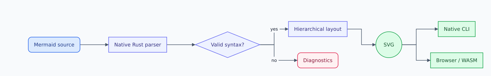
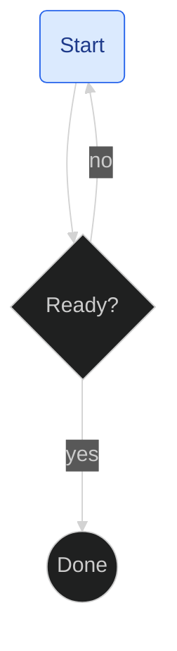

# diagram-rs

**Native Mermaid-compatible diagrams, from Rust to SVG.**



This diagram is rendered by **diagram-rs itself** from [examples/hero.mmd](examples/hero.mmd).
The parser, graph representation, layout and SVG renderer are native Rust. The
CLI works without Node.js, Chromium, installed fonts, or network access.

Six diagram families have native parsers, typed representations and renderers:
**flowchart, sequence, class, state, entity relationship and Gantt**. Each supports
a documented subset with source-located errors. See [supported syntax and limits](docs/syntax.md).
SVG coordinates and appearance are not pixel-identical to Mermaid.js.

## Features

- `flowchart` / `graph`, all five Mermaid direction spellings.
- Rectangles, rounded rectangles, diamonds, circles, stadiums, subroutines and
  cylinders; multiline labels.
- Branches, merges, disconnected nodes, cycles and self-loops.
- Directed, undirected and bidirectional solid/dotted/thick edges, labels and
  minimum rank spans from extended link lengths.
- Nested subgraphs, safe node/edge styling and named classes.
- A genuine hierarchical layout: feedback-edge handling, ranks, dummy vertices,
  crossing-minimization sweeps, measured coordinates and orthogonal routing.
- Light/dark themes, deterministic XML-safe SVG, source-located errors.
- Shaped font outlines: measurement and output use the same bundled DejaVu Sans.
- Sequence lifelines/fragments/activations; class compartments/UML relations;
  state pseudostates/transitions; ER tables/cardinalities; Gantt dates/dependencies.
- Japanese labels via bundled Noto Sans JP fallback, with a smaller Latin-only build option.
- Browser WebAssembly package with actual ESM exports and TypeScript declarations.
- Geometry checks, SVG/PNG regression baselines, CLI and browser tests.

## Install from source

Rust **1.90.0** is pinned; the workspace uses Rust 2024. Packages are not yet
published to crates.io or npm.

```sh
git clone https://github.com/rsasaki0109/diagram-rs.git
cd diagram-rs
cargo install --locked --path crates/diagram-cli
# Or: cargo build --locked --release -p diagram-cli
```

No JavaScript tooling is needed for native installation or normal rendering.
The optional npm dependencies are exclusively for development/browser testing.
Standard builds include a Japanese fallback font. For a smaller native binary:
`cargo install --locked --path crates/diagram-cli --no-default-features`.
See [bundled fonts and licenses](assets/fonts/README.md).

## CLI

```sh
diagram-rs input.mmd -o output.svg
diagram-rs render input.mmd --theme dark > output.svg
diagram-rs check input.mmd
printf 'flowchart LR; A[Input] --> B[SVG]' | diagram-rs -
diagram-rs --help
```

`check` validates syntax and IR; `render` also validates font coverage and layout.
Errors include file, one-based line and Unicode-aware column. Output defaults to
stdout. For glyphs beyond the bundled font, use `--font /path/to/font.ttf`.

```text
input.mmd:2:2: unsupported connector
```

## Rust API

Within this workspace, depend on `diagram-parser` and `diagram-render` (enable its `cjk` feature for Japanese). An external
checkout can use Git dependencies (once this source has been pushed):

```toml
[dependencies]
diagram-parser = { git = "https://github.com/rsasaki0109/diagram-rs" }
diagram-render = { git = "https://github.com/rsasaki0109/diagram-rs" }
```

```rust
let diagram = diagram_parser::parse_diagram("flowchart LR; A[Input] --> B[SVG]")?;
let svg = diagram_render::render_diagram(&diagram)?;
std::fs::write("output.svg", svg)?;
```

`diagram-core::Diagram` and each family IR are typed and Serde-serializable.
The original flowchart-only `parse`/`render` API remains available. `diagram_layout::layout`
returns node boxes, routes, ranks and crossing statistics. `Font::from_bytes` and
`render_with_font` accept a custom font. Public entry points validate IR built by
callers. Run `cargo doc --workspace --no-deps --locked` for API documentation.

## WebAssembly

```sh
cargo install wasm-bindgen-cli --version 0.2.105 --locked
scripts/build-wasm.sh
# Generates crates/diagram-wasm/pkg, including package.json, JS, WASM and .d.ts.
# Optional smaller build: scripts/build-wasm.sh --latin-only (pkg-latin/)
```

Install the generated local package in a browser application:

```sh
npm install /path/to/diagram-rs/crates/diagram-wasm/pkg
```

```ts
import { render, check, renderWithFont } from 'diagram-rs';

const svg = render(`
flowchart LR
    A[Input] --> B[Parser]
    B --> C[Layout]
    C --> D[SVG]
`);
document.querySelector('#diagram')!.innerHTML = svg;
```

The import initializes WASM with top-level await; subsequent rendering is
synchronous. Serve the `.wasm` asset with `application/wasm`. Browser ESM is
verified; bundlers need ESM/top-level-await and WASM-asset support. No Node WASM
package target or bundler-specific integration is claimed. See
[the WASM package README](crates/diagram-wasm/README.md). `examples/browser.html`
is an interactive example after the package is built and the repository is served
with a local HTTP server.

The optional Latin-only WASM is about **1.88 MB** (0.80 MB gzip), compared with
11.47 MB for the default Japanese build in the current local measurements.
It uses the same six-family API; Japanese requires `renderWithFont` and a separately
loaded font. See [measurements](benchmarks/README.md) and [release guide](docs/releases.md).

## Supported flowchart syntax

For all six families, see [the syntax reference](docs/syntax.md).

| Category | Supported forms |
| --- | --- |
| Header | `flowchart TB` or `graph TB`; `TB`, `TD`, `BT`, `LR`, `RL` |
| IDs | ASCII letters, digits and underscores |
| Nodes | `A`, `A[Label]`, `A(Label)`, `A{Label}`, `A((Label))`, `A([Label])`, `A[[Label]]`, `A[(Label)]` |
| Labels | Quoted or plain; newline, `\n`, `<br>`, `<br/>`, `<br />`; basic named/decimal entities |
| Edges | `-->`, `---`, `-.->`, `-.-`, `==>`, `===` |
| Bidirectional edges | `<-->`, `<-.->`, `<==>` (also with extra link characters) |
| Link lengths | Extra `-`, `=` or `.` increase the minimum rank span: `--->`, `====`, `-..->` |
| Edge labels | `A -->\|text\| B` (without the backslashes), `A -- text --> B` |
| Chains / fanout | `A --> B --> C`, `A & B --> C & D` |
| Groups | `subgraph id [Title]` … `end`, nesting up to 32 levels, global direction |
| Styles | `style A fill:#fff,stroke:#333,color:#111,stroke-width:2px,font-size:15px` |
| Classes | `classDef name …`, `class A,B name`, `A:::name`; named classes and `default` |
| Edge styles | `linkStyle 0,1 …` or `linkStyle default …`, zero-based insertion indices |
| Config | Strict JSON init directive with `theme`, `flowchart.nodeSpacing`, `flowchart.rankSpacing` |
| Statements | Newlines or semicolons; `%%` comments |

For example:



Other shapes, subgraph endpoints/local directions,
source-only/circle/cross arrowheads, edge IDs, Markdown formatting, HTML labels,
frontmatter/YAML, single-quoted init objects, interactions, animations and arbitrary
CSS are unsupported. HTML-like label text is rendered literally, except supported
line breaks. Colors are hex or a small set of literal names; URLs/CSS variables are
rejected. Style support is intentionally narrower than browser CSS.

Limits: 128 KiB input, 512 nodes, 2,048 edges, 4 KiB/32-line labels, and 8,192
expanded layout vertices. Source link lengths clamp to ten ranks, matching
Mermaid; directly constructed IR supports spans of 1–32. Self-loops ignore spans. Dense/parallel edges may share routing channels; crossing
minimization is heuristic. An unplaceable label/title route is diagnosed rather
than silently overlapping it. No claim of optimal layout is made.

The default font collection covers Japanese through Noto Sans JP fallback, plus
Latin, Greek, Cyrillic and other glyphs in DejaVu Sans. Unsupported characters return
errors. A caller-supplied font replaces the collection. Full mixed paragraph bidi
and emoji fallback are not supported. Outlined text has titles/ARIA labels but is
not selectable SVG text. Font notices are retained in SVG metadata when used.

## Architecture

| Crate | Responsibility |
| --- | --- |
| `diagram-core` | Typed diagram families, spans, validation and serialization |
| `diagram-parser` | Family-specific Mermaid subset parsers and diagnostics |
| `diagram-layout` | Hierarchical routing and specialized sequence/Gantt timelines |
| `diagram-render` | Native shaping, font metrics, themes and SVG |
| `diagram-cli` | Files, stdin/stdout, validation and diagnostics |
| `diagram-wasm` | Browser exports and shared Rust pipeline |

Read [architecture](docs/architecture.md) and [research and licensing](docs/research.md)
for the algorithm, existing implementations, decisions and constraints.

## Validation and performance

```sh
cargo fmt --all --check
cargo clippy --workspace --all-targets --locked -- -D warnings
cargo test --workspace --locked
```

Native tests cover syntax, diagnostics, invalid IR, generated graphs, all layout
directions, overlap/obstruction, font metrics, XML safety, determinism, CLI behavior,
and SVG/PNG baselines for every diagram family. The optional browser tests verify WASM/native output
parity, custom fonts and error handling. A separate Mermaid 11.12.0 reference test
checks 149 cases across all six families for matching entities, relationships,
arrows, cardinalities, sequence messages and task dates, and renders them.
Deterministic mutation campaigns exercise 6,000 parser inputs and 720 renderer
inputs; these bounded campaigns are not exhaustive or coverage-guided fuzzing.
Strict TypeScript contracts and a real esbuild browser bundle are also tested.
This is not comprehensive Mermaid compatibility certification.

Measured stage timings, process memory, native/WASM sizes and methodology are in
[benchmarks](benchmarks/README.md). No comparative speedup is claimed.

Local versioned archives and their checksums are under `dist/`;
see [installation and release review](docs/releases.md). Packages remain unpublished.

## Roadmap

Track the accepted 80% development target and evidence-based planning score in
[the maturity assessment](docs/maturity.md).

- Expand compatibility and add sustained coverage-guided fuzzing.
- Improve compound/dense routing, composite states, sequence actor boxes and Gantt working-day rules.
- Validate native/browser integration, package artifacts and supported platforms.
- Add full paragraph bidi, emoji fallback and selectable text/accessibility options.

See [contributing](CONTRIBUTING.md). Project code is [MIT](LICENSE); the bundled
[font license](assets/fonts/LICENSE.txt) is separate. No crates or npm packages
have been published. When distributing native binaries, also ship `LICENSE`,
`THIRD_PARTY_LICENSES.txt`, `assets/fonts/LICENSE.txt` and
`assets/fonts/NotoSansJP-OFL.txt`. The generated WASM
package includes these notices.
